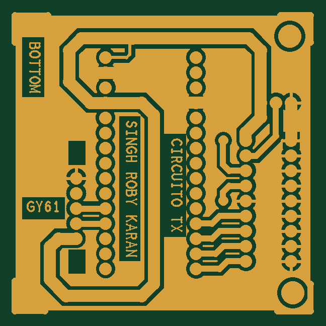
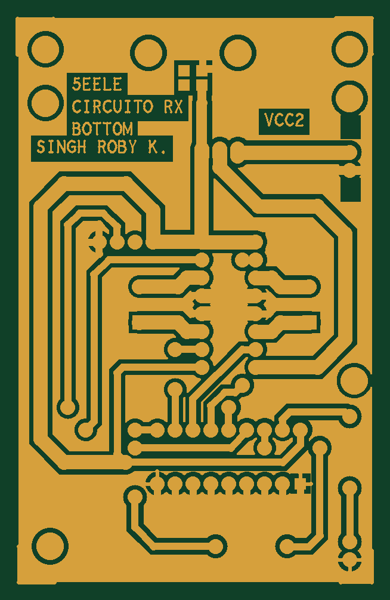
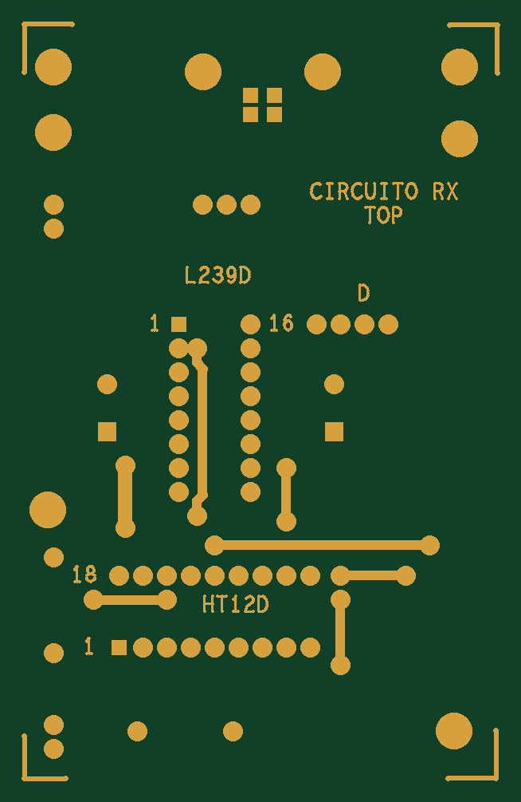

# Gesture-controlled robot

**Diploma project, ITIS "E. Fermi", Mantua, Italy (2018)**
Original title: *La comunicazione gestuale* ("Gesture communication")

Tilt your hand and the robot drives. An accelerometer on the hand reads the gesture, an Arduino Nano turns it into a 4-bit command, and a 433 MHz radio link sends it to the robot, where a decoder chip drives the motors directly. I wrote the firmware and designed both circuit boards.

<p align="center">
  
  
  
</p>
<p align="center"><sub>Transmitter board · receiver board (bottom) · receiver board (top), rendered from the original Gerber files</sub></p>

---

## How it works

```
 HAND (transmitter)                                     ROBOT (receiver)
 ┌──────────────┐  analog  ┌─────────────┐  4 bits  ┌────────┐   433 MHz   ┌────────┐  4 bits  ┌────────┐     ┌─────────┐
 │ ADXL335      │ ───────► │ Arduino Nano│ ───────► │ HT12E  │ ~~~~~~~~~~► │ HT12D  │ ───────► │ L293D  │ ──► │ 2 DC    │
 │ accelerometer│  X, Y    │ ADC + logic │  D9–D12  │ encoder│   RF link   │ decoder│          │ H-bridge│    │ motors  │
 └──────────────┘          └─────────────┘          └────────┘             └────────┘          └────────┘     └─────────┘
```

1. The **ADXL335** (on a GY-61 module) outputs the hand's tilt as two analog voltages, X and Y.
2. The **Arduino Nano** reads them with its 10-bit ADC and checks which window they fall in.
3. Each window maps to a command on four digital pins (D9 to D12), wired to the data inputs of an **HT12E** encoder.
4. The HT12E serialises the 4 bits and sends them over a **433 MHz** RF transmitter.
5. On the robot, an **HT12D** decoder recovers the 4 bits and drives an **L293D** H-bridge, which turns the two motors. The receiver needs no microcontroller and no code.

## Gesture commands

| Gesture | X reading | Y reading | D9 | D10 | D11 | D12 | Robot |
|---------|-----------|-----------|:--:|:---:|:---:|:---:|-------|
| Hand flat | 320–380 | 340–395 | 0 | 0 | 0 | 0 | Stop |
| Tilt forward | 280–340 | 340–395 | 0 | 1 | 1 | 0 | Forward |
| Tilt back | 380–430 | 340–395 | 1 | 0 | 0 | 1 | Reverse |
| Tilt to one side | 300–395 | 375–435 | 1 | 0 | 0 | 0 | Turn |
| Tilt to the other side | 300–395 | 280–325 | 0 | 0 | 0 | 1 | Turn |

The thresholds came from calibrating the accelerometer by hand: I held it in each position and logged the raw ADC values over serial. The "hand flat" check runs first, so it wins where its window overlaps forward.

## Hardware

| Board | Components |
|-------|-----------|
| Transmitter (on the hand) | Arduino Nano, ADXL335 / GY-61 accelerometer, HT12E encoder, 433 MHz RF transmitter |
| Receiver (on the robot) | 433 MHz RF receiver, HT12D decoder, L293D motor driver, 2 DC motors |

Both PCBs were designed in **OrCAD / Cadence Allegro 16.6**.

## Files

| File | What it is |
|------|-----------|
| `gesture_control_robot.ino` | Transmitter firmware: reads the accelerometer and sets the 4-bit command (comments in Italian) |
| `motor_test.ino` | Bench test that steps the outputs through each direction every 3 seconds |
| `pcb/` | Original board files: Gerber artwork (`.art`) and Allegro board files (`.brd`) for the transmitter (`tx`) and receiver (`rx`), plus rendered images |

## Author

**Roby Karan Singh**: BEng Electronic & Electrical Engineering (First Class), MSc Computer Science (Distinction), Swansea University.
[Portfolio](https://robysingh.github.io) · [LinkedIn](https://www.linkedin.com/in/roby-ksingh/)
